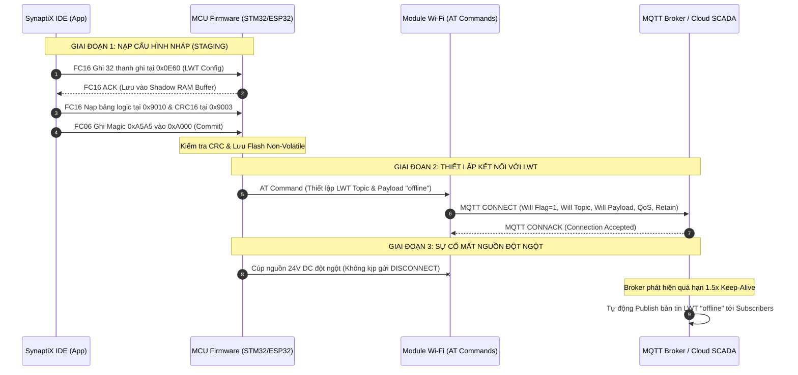

# TÀI LIỆU ĐẶC TẢ GIAO DIỆN TRUYỀN THÔNG (ICD)
## PHÂN HỆ MQTT LAST WILL & TESTAMENT (LWT) CHO FIRMWARE MCU
**Mã tài liệu:** `SPLC-SPEC-MQTT-004`  
**Phiên bản:** `2.0.0`  
**Ngày ban hành:** `2026-11-12`  
**Đơn vị ban hành:** Ban Công Nghệ & Tự Động Hóa SynaptiX  
**Tiêu chuẩn liên quan:** IEC 61131-3, Modbus Application Protocol V1.1b3, OASIS MQTT V3.1.1/V5.0 RFC  

---

## 1. TỔNG QUAN PHÂN HỆ (SYSTEM OVERVIEW)

### 1.1. Mục đích & Vai trò Công nghiệp của LWT
Trong các hệ thống tự động hóa công nghiệp và giám sát trạm biên (IIoT Edge Gateway), việc phát hiện kịp thời các sự cố trạm mất nguồn 24V DC đột ngột, cháy nổ nguồn xung, hoặc đứt cáp quang/mất sóng viễn thông là yêu cầu an toàn bắt buộc. Khi xảy ra sự cố đột ngột, thiết bị không kịp gửi gói tin `DISCONNECT` hợp lệ lên máy chủ.

Tính năng **MQTT Last Will & Testament (LWT)** cho phép thiết bị đăng ký trước một thông điệp di chúc khẩn cấp ngay trong gói bắt tay `CONNECT` với Broker:
- Nếu thiết bị mất kết nối bất thường (vượt quá `1.5x Keep-Alive` mà không có tín hiệu sống `PINGREQ`), Broker sẽ **tự động thay mặt thiết bị** phát tán bản tin LWT này lên topic giám sát.
- Hệ thống trung tâm SCADA / Cloud lập tức kích hoạt cảnh báo trạm Offline mà không cần chờ timeout quét định kỳ.



---

## 2. PHÂN BỔ BỘ NHỚ MODBUS HOLDING REGISTERS

Phân vùng cấu hình MQTT Last Will & Testament được ánh xạ cố định trong không gian Modbus Holding Registers:
- **Địa chỉ cơ sở (Base Address):** `0x0E60`
- **Số lượng thanh ghi:** `32` Holding Registers (`0x0E60` – `0x0E7F`) = `64` Bytes.
- **Mã hàm Modbus hỗ trợ:** `FC03` (Read Holding Registers), `FC16` (Write Multiple Registers).
- **Thứ tự byte:** Big-Endian (High Byte trước, Low Byte sau).

### 2.1. Bảng Bố Cục Chi Tiết (Register Layout)

| Địa chỉ Modbus | Tên trường | Kiểu dữ liệu | Kích thước | Truy cập | Mô tả chi tiết & Quy ước kỹ thuật |
| :--- | :--- | :---: | :---: | :---: | :--- |
| **`0x0E60`** (`+0`) | `WILL_CONTROL` | `UINT16` | 1 reg (2B) | R/W | **Thanh ghi điều khiển LWT:**<br>• **Bit 0 (`0x0001`):** `WILL_ENABLED` (`1` = Bật LWT, `0` = Tắt LWT).<br>• **Bit 1 (`0x0002`):** `WILL_RETAIN` (`1` = Bật Retain, `0` = Tắt Retain).<br>• **Bit 2..3 (`0x000C`):** `WILL_QOS` (Mức dịch vụ Will QoS):<br>&nbsp;&nbsp;- `00b` (`0`): QoS 0 (At most once)<br>&nbsp;&nbsp;- `01b` (`1`): QoS 1 (At least once - Khuyến nghị)<br>&nbsp;&nbsp;- `10b` (`2`): QoS 2 (Exactly once)<br>• **Bit 4..15:** Dự phòng (Reserved, luôn ghi `0`). |
| **`0x0E61..0x0E70`** (`+1..+16`) | `WILL_TOPIC` | `char[32]` | 16 regs (32B) | R/W | **Chủ đề LWT (Topic):** Chuỗi ký tự ASCII Packed (2 ký tự / thanh ghi Big-Endian). Độ dài tối đa 32 ký tự, kết thúc bằng byte `0x00` hoặc đệm toàn bộ byte thừa bằng `0x00`. |
| **`0x0E71..0x0E7F`** (`+17..+31`) | `WILL_PAYLOAD` | `char[30]` | 15 regs (30B) | R/W | **Nội dung bản tin LWT (Payload):** Chuỗi ký tự ASCII Packed (2 ký tự / thanh ghi Big-Endian). Độ dài tối đa 30 ký tự, kết thúc bằng byte `0x00` hoặc đệm toàn bộ byte thừa bằng `0x00`. |

---

## 3. KHAI BÁO C STRUCT CHUẨN CHO FIRMWARE MCU

Khai báo chính thức trong firmware header `simpleplc_protocol_v2_0.h`:

```c
/* --- 2.7.1 MQTT Last Will & Testament (LWT) (0x0E60 - 0x0E7F, SPLC-SPEC-MQTT-004) --- */
#define SPLC_ADDR_MQTT_WILL               0x0E60  /* 32 regs (64 B): SPLC_MqttWillConfig_t (FC03/FC16, RW) */
#define SPLC_LEN_MQTT_WILL                32
#define SPLC_MQTT_WILL_TOPIC_MAX_CHARS    32
#define SPLC_MQTT_WILL_PAYLOAD_MAX_CHARS  30

#define SPLC_MQTT_WILL_CTRL_ENABLED_BIT   0x0001  /* Bit 0: 1=Enabled, 0=Disabled */
#define SPLC_MQTT_WILL_CTRL_RETAIN_BIT    0x0002  /* Bit 1: 1=Retain, 0=No Retain */
#define SPLC_MQTT_WILL_CTRL_QOS_MASK      0x000C  /* Bit 2..3: QoS (0, 1, 2) */
#define SPLC_MQTT_WILL_CTRL_QOS_SHIFT     2

typedef struct SPLC_PACKED {
    uint16_t will_control;                        /* +0: Bit 0=Enabled, Bit 1=Retain, Bit 2..3=QoS */
    char     will_topic[32];                      /* +1..16: Topic (32 bytes ASCII) */
    char     will_payload[30];                    /* +17..31: Payload (30 bytes ASCII) */
} SPLC_MqttWillConfig_t;

/* Kiểm tra tĩnh kích thước bộ nhớ tại thời điểm biên dịch */
_Static_assert(sizeof(SPLC_MqttWillConfig_t) == 64, "MqttWillConfig must be 64 bytes (32 regs)");
```

---

## 4. CHU TRÌNH NẠP DEPLOY & ATOMIC COMMIT HAI PHA

Nhằm đảm bảo an toàn tuyệt đối, phân hệ LWT tuân thủ nghiêm ngặt mô hình **Two-Phase Deploy**:

```
[ App: Nạp nháp 0x0E60 ] ──> [ MCU: Giữ trong Shadow RAM ]
                                         │
[ App: Ghi Magic 0xA5A5 tại 0xA000 ] ──> [ MCU: Commit Flash & Restart MQTT ]
```

1. **Pha 1 — Nạp vào vùng nhớ nháp (Shadow RAM Buffer):**
   - Khi kỹ sư nhấn Deploy trên SynaptiX IDE, App phát lệnh Modbus FC16 ghi 32 thanh ghi vào địa chỉ `0x0E60`.
   - Firmware MCU tiếp nhận và copy vào biến struct tạm thời trong RAM (`g_shadow_lwt_cfg`).
   - Tại thời điểm này, **chưa được ghi đè vào Flash** và **chưa thay đổi phiên kết nối MQTT đang chạy**.
2. **Pha 2 — Xác thực & Chốt nguyên tử (Atomic Commit):**
   - App hoàn tất nạp bảng luật vào vùng Staging `0x9010` và ghi Magic Number `0xA5A5` vào thanh ghi `0xA000`.
   - Firmware thực thi quy trình commit:
     - Kiểm tra toàn vẹn mã CRC-16 của bảng logic.
     - Kiểm tra tính hợp lệ của cấu hình LWT (xem Mục 6).
     - Ghi đồng bộ cấu hình LWT từ Shadow RAM vào phân vùng Flash Non-Volatile.
     - Tái khởi tạo kết nối MQTT Client (qua module Wi-Fi) với các tham số LWT mới.
     - Cập nhật số phiên bản cấu hình `ACTIVE_RULE_VERSION` (`0xA001`) tăng lên +1.

---

## 5. CƠ CHẾ VÔ HIỆU HÓA / TẮT LWT

Khi người dùng bỏ chọn kích hoạt LWT trên SynaptiX IDE (`Enabled = false`):
1. **Trách nhiệm của App:**
   - App **bắt buộc phát lệnh ghi Modbus FC16** xuống `0x0E60` với:
     - `will_control = 0x0000` (Bit 0 = 0).
     - Toàn bộ 31 thanh ghi Topic và Payload được xóa sạch về `0x0000`.
2. **Xử lý phía Firmware:**
   - Khi nhận được thanh ghi `will_control` có `Bit 0 == 0`:
     - Firmware ghi nhận trạng thái LWT là **DISABLED**.
     - Khi lưu Flash và khởi động lại phiên MQTT qua module Wi-Fi, Firmware thiết lập cờ **Will Flag = 0** trong gói bắt tay `CONNECT` (không truyền tham số LWT).

---

## 6. QUY TẮC CHUỖI & PHÒNG VỆ LỆNH AT (WI-FI AT COMMAND DEFENSE)

### 6.1. Hạn Chế Của Module Wi-Fi Qua Lệnh AT
Module Wi-Fi (ESP32/ST67W) nhận cấu hình MQTT từ MCU qua đường truyền UART bằng tập lệnh AT chuẩn (ví dụ: `AT+MQTTCFG="..."`). Trong cú pháp lệnh AT:
- Ký tự dấu ngoặc kép `"` là ký tự phân cách (delimiter) của chuỗi tham số.
- Ký tự gạch chéo ngược `\` thường gây lỗi thoát chuỗi (escape sequence) không đồng nhất giữa các phiên bản firmware Wi-Fi.

### 6.2. Phân Công Trách Nhiệm Giữa App & Firmware

```
[ Operator Nhập Trên App ] 
         │ (Chặn ký tự " và \, tự động gán Topic/Payload chuẩn)
         ▼
[ App Resolve Token {device} -> Chuỗi Literal ]
         │ (Ghi Modbus FC16 xuống 0x0E60)
         ▼
[ MCU Đọc Chuỗi Thô Literal ] ──> [ Ghép Lệnh AT Module Wi-Fi An Toàn 100% ]
```

1. **Bộ lọc an toàn phía App (Input Sanitization):**
   - **Chặn ký tự nguy hiểm:** Ô nhập `WillTopic` và `WillPayload` trên giao diện App chặn hoàn toàn dấu nháy kép `"`, dấu gạch chéo ngược `\` và các ký tự điều khiển không in được (`ASCII < 0x20` hoặc `> 0x7E`).
   - **Chuẩn hóa giá trị mặc định:** Nội dung Payload mặc định được thiết lập là chuỗi văn bản thuần túy: **`"offline"`** (hoặc `"0"`), loại bỏ hoàn toàn mẫu JSON chứa dấu nháy kép `{"status":"offline"}`.
   - **Tự động phân giải Token:** Nếu người dùng sử dụng token macro `{device}`, App sẽ tự động thay thế bằng mã `CLIENT_ID` thực tế trước khi đóng gói nhị phân gửi xuống `0x0E60`.
2. **Trách nhiệm của Firmware:**
   - Firmware coi chuỗi nhận được tại `will_topic` và `will_payload` là **chuỗi thô cuối cùng (literal string)**.
   - Firmware **không cần parse hay replace token**, chỉ việc đọc chuỗi kết thúc bởi `\0` và truyền thẳng vào lệnh AT của module Wi-Fi.

---

## 7. XỬ LÝ LỖI & THẨM ĐỊNH TÍNH HỢP LỆ (VALIDATION & ERROR HANDLING)

Theo nguyên tắc phòng thủ đa tầng (**Defense in Depth**), cả App và Firmware đều tham gia chốt chặn:

| Tình huống lỗi | Xử lý phía App | Xử lý phía Firmware | Mã lỗi phản hồi |
| :--- | :--- | :--- | :---: |
| **`Enabled = 1` nhưng Topic rỗng** | Khóa nút Deploy, viền đỏ ô nhập liệu, hiển thị tooltip cảnh báo. | Từ chối lệnh COMMIT tại `0xA000`, giữ nguyên cấu hình Flash cũ. | `CONFIG_ERROR_CODE = 0x0001`<br>(`INVALID_PARAMETER`) |
| **Độ dài Topic > 32 ký tự** | Giới hạn `MaxLength = 32` trên TextBox. | Tự động ngắt chuỗi tại byte thứ 31 và chèn byte `0x00` kết thúc. | - |
| **Độ dài Payload > 30 ký tự** | Giới hạn `MaxLength = 30` trên TextBox. | Tự động ngắt chuỗi tại byte thứ 29 và chèn byte `0x00` kết thúc. | - |
| **QoS > 2** | ComboBox UI chỉ cho chọn 0, 1, 2. | Ép mức QoS về giá trị mặc định `1` (`(qos & 0x03) <= 2 ? qos : 1`). | - |

---

## 8. MA TRẬN KIỂM THỬ & TIÊU CHUẨN NGHIỆM THU FIRMWARE

Mỗi bản dựng Firmware hỗ trợ MQTT bắt buộc phải vượt qua checklist nghiệm thu sau trước khi xuất xưởng:

- [ ] **LWT-TC01 (Nạp & Đọc lại):** Ghi 32 thanh ghi vào `0x0E60` qua FC16 $\rightarrow$ Đọc lại qua FC03 trả về 100% khớp dữ liệu.
- [ ] **LWT-TC02 (Từ chối Topic rỗng):** Bật `will_control = 0x0001` nhưng gửi Topic toàn `0x00` $\rightarrow$ Gửi Commit `0xA5A5` vào `0xA000` $\rightarrow$ MCU từ chối, `0x9000 = 4 (ERROR)` và `0x9001 = 1 (INVALID_PARAMETER)`.
- [ ] **LWT-TC03 (Vô hiệu hóa an toàn):** Gửi `will_control = 0x0000` $\rightarrow$ Commit $\rightarrow$ MCU kết nối MQTT không còn cờ Will Flag.
- [ ] **LWT-TC04 (Lưu Flash Non-Volatile):** Nạp cấu hình LWT $\rightarrow$ Commit $\rightarrow$ Tắt nguồn thiết bị $\rightarrow$ Bật lại nguồn $\rightarrow$ Đọc lại `0x0E60` giữ nguyên cấu hình đã lưu.
- [ ] **LWT-TC05 (Ký tự an toàn lệnh AT):** Gửi payload `"offline"` $\rightarrow$ Lệnh AT tới module Wi-Fi thực thi thành công không bị treo UART hoặc lỗi syntax.
- [ ] **LWT-TC06 (Phát hiện cúp nguồn thực tế):** Kết nối Broker $\rightarrow$ Rút dây nguồn 24V DC đột ngột $\rightarrow$ Sau $1.5\times$ Keep-Alive, Broker tự động publish bản tin LWT `"offline"` tới Subscriber.
