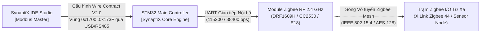

# ĐẶC TẢ GIAO DIỆN TRUYỀN THÔNG (ICD): PHÂN HỆ ZIGBEE WIRELESS MODBUS
**Mã tài liệu:** `SPLC-SPEC-ZIGBEE-006-ICD`  
**Phiên bản:** `2.0.0` (Bản chuẩn chính thức - Authoritative Standard)  
**Tiêu chuẩn áp dụng:** SynaptiX Industrial Automation Platform V2.0 / IEEE 802.15.4 / IEC 62443-4-2 / IEC 61131-3  
**Phần cứng mục tiêu:** STM32 Main Controller kết hợp Module Zigbee RF (DRF1609H / CC2530 / E18) — Thiết bị tiêu biểu: **X.Link Zigbee 44**, **SX-DTU-485**  
**Phạm vi bộ nhớ:** `0x1700 .. 0x173F` (64 Holding Registers = 128 Bytes)

---

## 1. TỔNG QUAN & NGUYÊN TẮC KIẾN TRÚC

### 1.1. Bối cảnh & Phạm vi
Tài liệu này định nghĩa chi tiết Hợp đồng Giao tiếp Nhị phân (Wire Contract V2.0) giữa Máy tính điều khiển Host (**SynaptiX IDE Studio**) và Vi điều khiển trung tâm (**Main MCU - STM32**) kết hợp với Module truyền thông không dây Zigbee.

Module Zigbee hoạt động như một bus truyền thông **Modbus over Zigbee (Wireless Transport)** ở chế độ trong suốt (Transparent Mode), thay thế cho cáp nối tiếp RS-485 truyền thống.



### 1.2. Các Nguyên Tắc Kiến Trúc Bất Biến (Architectural Invariants)
1. **Phân Định Bản Chất Giao Diện (Visual Truth Invariant - Axiom 2):**
   - Zigbee là một **Loại giao tiếp không dây riêng (`Interface Type: Wireless Modbus Transport`)**, tuyệt đối không đồng nhất thành "Cổng RS-485 số 5" trên giao diện người dùng. Thiết bị X.Link 44 chỉ có 1 cổng RS-485 vật lý và 1 anten sóng.
   - Trong các khối logic FBD (`MB_READ` / `MB_WRITE`), cổng Zigbee được mã hóa với giá trị thô: **`PortIndex = 4`** (0-based: `0..3` cho RS-485 Port 1..4, `4` cho Zigbee Wireless).
2. **Khai Báo Năng Lực Phần Cứng (Hardware Capabilities):**
   - MCU có tích hợp module Zigbee phải bật cờ **`SPLC_CAP_ZIGBEE = 0x8000`** (Bit 15) trong thanh ghi `0x0A08`.
   - SynaptiX Studio đọc thanh ghi này để tự động hiển thị tab cấu hình Zigbee và tùy chọn `Zigbee (Wireless)` trong các khối logic. Thiết bị không có cờ này sẽ ẩn hoàn toàn.
3. **Bảo Vệ Phân Vùng Nhạy Cảm (Sandbox Security):**
   - Phân hệ Zigbee chỉ đóng vai trò Slave dữ liệu I/O qua bản đồ cố định `SLAVE-001` (DI, DO, VFLAG, VREG, COUNTER).
   - **Tuyệt đối KHÔNG mở quyền nạp Rule Table (`0x0000..0xA001`) qua sóng không dây** để phòng ngừa tấn công chiếm quyền điều khiển nhà máy.
4. **Bảo Mật Khóa Mạng AES-128 (Write-Only Key Protection):**
   - Khóa mạng 16 byte (`0x1710..0x1717`) là **Write-Only (Chỉ ghi)**, đọc lại qua Modbus luôn trả về `0x00` để chống trích xuất khóa qua sóng RF.
   - Hỗ trợ cờ điều khiển `PRESERVE_KEY` (Bit 5 tại `+0`) khi Deploy logic mà không đổi key và cờ trạng thái `KEY_SET` (Bit 0 tại `+36`) báo trạng thái đã lưu key trong Flash.

---

## 2. BẢN ĐỒ BỘ NHỚ THANH GHI MODBUS (0x1700 .. 0x173F)

Toàn bộ cấu hình và viễn trắc của phân hệ Zigbee được gói gọn trong **64 Holding Registers (128 Bytes)**:

| Vùng Holding Registers | Tên phân vùng | Chiều | Mã hàm | Kích thước | Mô tả kỹ thuật |
| :--- | :--- | :---: | :---: | :---: | :--- |
| **`0x1700 .. 0x170F`** | **RF Parameters & Modbus Setup** | R/W | FC03 / FC16 | 16 regs (32 B) | Cấu hình cờ điều khiển, kênh sóng, PAN ID, địa chỉ mạng, ăng-ten, và Slave ID. |
| **`0x1710 .. 0x1717`** | **AES-128 Network Security Key** | **WO** | FC16 | 8 regs (16 B) | 16 byte khóa bí mật AES-128 (Write-Only, đọc luôn trả `0x00`). |
| **`0x1718 .. 0x171F`** | **Device Node Name (ASCII)** | R/W | FC03 / FC16 | 8 regs (16 B) | Tên gợi nhớ của nút (tối đa 15 ký tự ASCII + null-terminator). |
| **`0x1720 .. 0x1723`** | **Reserved Config** | R/W | FC03 / FC16 | 4 regs (8 B) | Dự phòng mở rộng tham số cấu hình. |
| **`0x1724 .. 0x173F`** | **Live Telemetry & Diagnostics** | **RO** | FC03 | 28 regs (56 B) | Viễn trắc thời gian thực: Link State, RSSI, LQI, bộ đếm gói TX/RX, mã lỗi. |

---

## 3. ĐẶC TẢ CHI TIẾT CẤU TRÚC THANH GHI

Cấu trúc nhị phân C tương ứng: `SPLC_ZigbeeConfigRecord_t` (chuẩn hóa 128 bytes, đóng gói `packed`).

| Offset | Địa chỉ Modbus | Tên trường | Kiểu dữ liệu | Quyền | Mô tả chi tiết kỹ thuật |
| :---: | :---: | :--- | :---: | :---: | :--- |
| **+0** | `0x1700` | `control_flags` | `uint16_t` | R/W | **Bitmask điều khiển phân hệ:**<br>• Bit 0: `ENABLE` (1 = Bật Zigbee, 0 = Tắt)<br>• Bit 1: `ROLE` (0 = Master/Coordinator, 1 = Slave/Router)<br>• Bit 2: `FRAMING` (0 = RTU nhị phân, 1 = ASCII — hiện chỉ nhận 0)<br>• Bit 3: `SECURITY_ENABLE` (1 = Bật mã hóa AES-128 CCM*)<br>• Bit 4: `ANTENNA` (0 = On-board PCB, 1 = External SMA)<br>• Bit 5: `PRESERVE_KEY` (1 = Giữ nguyên key cũ trong Flash khi commit)<br>• Bit 6..15: Bắt buộc ghi 0 |
| **+1** | `0x1701` | `channel` | `uint16_t` | R/W | Kênh tần số RF (11 .. 26, tương ứng 2405 .. 2480 MHz). Khuyến nghị: 15, 20, 25, 26 (tránh trùng kênh Wi-Fi 1, 6, 11). |
| **+2** | `0x1702` | `pan_id` | `uint16_t` | R/W | Mã định danh mạng vô tuyến (0x0001 .. 0xFFFE). |
| **+3** | `0x1703` | `local_addr` | `uint16_t` | R/W | Địa chỉ ngắn nội bộ trong mạng Zigbee (0x0000 .. 0xFFFD). Thường Coordinator là `0x0000`. |
| **+4** | `0x1704` | `dest_addr` | `uint16_t` | R/W | Địa chỉ đích khi phát (0x0000 Coordinator, 0xFFFF Broadcast). |
| **+5** | `0x1705` | `power_level` | `uint16_t` | R/W | Mức công suất phát RF (0 = Min, 4 = Max +20 dBm). |
| **+6** | `0x1706` | `baud_rate_idx` | `uint16_t` | R/W | Tốc độ UART nội bộ MCU-RF (0=9600, 1=19200, 2=38400, 3=57600, 4=115200). |
| **+7** | `0x1707` | `parity` | `uint16_t` | R/W | Chẵn lẻ UART (0 = None, 1 = Even, 2 = Odd). |
| **+8** | `0x1708` | `data_bits` | `uint16_t` | R/W | Số bit dữ liệu (Cố định 8). |
| **+9** | `0x1709` | `stop_bits` | `uint16_t` | R/W | Số bit dừng (1 hoặc 2). |
| **+10** | `0x170A` | `response_timeout_ms`| `uint16_t` | R/W | Thời gian chờ phản hồi khung Modbus qua sóng (Khuyến nghị: 1500 .. 2000 ms cho mạng Mesh). |
| **+11** | `0x170B` | `inter_frame_delay_ms`| `uint16_t` | R/W | Khoảng cách trễ giữa hai khung truyền (Khuyến nghị: 150 .. 200 ms). |
| **+12** | `0x170C` | `retry_count` | `uint16_t` | R/W | Số lần thử lại khi mất gói vô tuyến (0 .. 5 lần). |
| **+13** | `0x170D` | `slave_id` | `uint16_t` | R/W | **Địa chỉ trạm Modbus (1 .. 247).**<br>🚨 **CẤM:** ID `236 (0xEC)` và `237 (0xED)` vì trùng byte lệnh cấu hình nội bộ của module RF. |
| **+14..+15**| `0x170E..0x170F`| `reserved1[2]` | `uint16_t[2]`| R/W | Dự phòng căn lề cấu hình (ghi 0). |
| **+16..+23**| `0x1710..0x1717`| `network_key[16]`| `uint8_t[16]`| **WO** | 16 byte khóa bí mật AES-128. Đọc qua Modbus luôn trả về 0x00. |
| **+24..+31**| `0x1718..0x171F`| `network_name[16]`| `char[16]` | R/W | Tên thân thiện của nút (tối đa 15 ký tự ASCII + null). |
| **+32..+35**| `0x1720..0x1723`| `reserved2[4]` | `uint16_t[4]`| R/W | Dự phòng mở rộng (ghi 0). |
| **+36** | `0x1724` | `status_flags` | `uint16_t` | **RO** | **Cờ trạng thái viễn trắc:**<br>• Bit 0: `KEY_SET` (1 = Đã có khóa AES hợp lệ trong Flash, 0 = Chưa có khóa). |
| **+37** | `0x1725` | `link_state` | `uint16_t` | **RO** | Trạng thái mạng: `0 = DISCONNECTED`, `1 = JOINING`, `2 = LINK_UP (Hoạt động)`, `3 = ERROR`. |
| **+38** | `0x1726` | `rssi_dbm` | `int16_t` | **RO** | Cường độ tín hiệu nhận được tính bằng dBm có dấu (ví dụ: `-64`). |
| **+39** | `0x1727` | `lqi` | `uint16_t` | **RO** | Chỉ số chất lượng đường truyền (0 .. 255). |
| **+40** | `0x1728` | `tx_packets` | `uint16_t` | **RO** | Bộ đếm gói tin đã truyền thành công. |
| **+41** | `0x1729` | `rx_packets` | `uint16_t` | **RO** | Bộ đếm gói tin đã nhận thành công. |
| **+42** | `0x172A` | `tx_errors` | `uint16_t` | **RO** | Bộ đếm lỗi phát gói tin. |
| **+43** | `0x172B` | `rx_errors` | `uint16_t` | **RO** | Bộ đếm lỗi nhận gói (CRC / Timeout). |
| **+44** | `0x172C` | `error_code` | `uint16_t` | **RO** | Mã lỗi phần cứng chuẩn hóa (`0 = NONE`, `1 = TIMEOUT`, `2 = INVALID_RF_PARAM`, `3 = RESTRICTED_ID`, `4 = JOIN_FAILED`, `5 = KEY_REJECTED`, `6 = HW_FAULT`). |
| **+45..+63**| `0x172D..0x173F`| `reserved3[19]`| `uint16_t[19]`| **RO** | Dự phòng viễn trắc tương lai. |

---

## 4. ĐẶC TẢ C/C++ HEADER CHO EMBEDDED FIRMWARE

Định nghĩa struct chuẩn C99/C11 khớp 1:1 trong [`simpleplc_protocol_v2_0.h`](file:///g:/HoaNV/Projects/SimplePLC/src/SimplePLC.Protocol/Firmware/simpleplc_protocol_v2_0.h):

```c
#pragma pack(push, 1)

typedef struct SPLC_PACKED {
    uint16_t control_flags;         /* +0: Bit 0=En, 1=Role(0=M,1=S), 2=Framing(0=RTU), 3=SecEn, 4=Ant(0=PCB,1=Ext), 5=PreserveKey */
    uint16_t channel;               /* +1: RF Channel (11..26) */
    uint16_t pan_id;                /* +2: PAN ID (0x0001..0xFFFE) */
    uint16_t local_addr;            /* +3: Local Short Address (0x0000..0xFFFD) */
    uint16_t dest_addr;             /* +4: Destination Short Address (0x0000..0xFFFF) */
    uint16_t power_level;           /* +5: Transmit Power Level (0..4) */
    uint16_t baud_rate_idx;         /* +6: Module UART Baud Index (0..4) */
    uint16_t parity;                /* +7: Parity (0=None, 1=Even, 2=Odd) */
    uint16_t data_bits;             /* +8: Data Bits (8) */
    uint16_t stop_bits;             /* +9: Stop Bits (1..2) */
    uint16_t response_timeout_ms;   /* +10: Response Timeout ms (50..5000) */
    uint16_t inter_frame_delay_ms;  /* +11: Inter-frame Delay ms (10..500) */
    uint16_t retry_count;           /* +12: Retries (0..5) */
    uint16_t slave_id;              /* +13: Modbus Slave ID (1..247, cấm 236/237) */
    uint16_t reserved1[2];          /* +14..15: Reserved (4 bytes) */
    uint8_t  network_key[16];       /* +16..23: AES-128 Encryption Key (Write-Only, reads 0) */
    char     network_name[16];      /* +24..31: Network Name ASCII (16 bytes) */
    uint16_t reserved2[4];          /* +32..35: Reserved (8 bytes) */
    
    /* Telemetry & Diagnostics Section (Read-Only) */
    uint16_t status_flags;          /* +36: Bit 0 = KEY_SET */
    uint16_t link_state;            /* +37: 0=Disconnected, 1=Joining, 2=Up, 3=Error */
    int16_t  rssi_dbm;              /* +38: Last packet RSSI in dBm */
    uint16_t lqi;                   /* +39: Link Quality Indicator (0..255) */
    uint16_t tx_packets;            /* +40: TX Packet Counter */
    uint16_t rx_packets;            /* +41: RX Packet Counter */
    uint16_t tx_errors;             /* +42: TX Error Counter */
    uint16_t rx_errors;             /* +43: RX Error Counter */
    uint16_t error_code;            /* +44: 0=None, 1=Timeout, 2=InvalidRF, 3=RestrictedId, 4=JoinFail, 5=KeyFail, 6=HwFault */
    uint16_t reserved3[19];         /* +45..63: Reserved (38 bytes) */
} SPLC_ZigbeeConfigRecord_t;

#pragma pack(pop)

/* Kiểm tra kích thước chính xác tại compile-time */
_Static_assert(sizeof(SPLC_ZigbeeConfigRecord_t) == 128, "ZigbeeConfigRecord must be 128 bytes (64 regs)");
```

---

## 5. HAI (02) QUY TẮC BẮT BUỘC FIRMWARE PHẢI TUÂN THỦ

1. 🚨 **Bắt Buộc Mặt Nạ (Mask) `rule_count & 0x00FF` khi Trả Về Modbus:**
   - Firmware có cơ chế lưu cờ *"Có dùng Zigbee"* vào **Bit 8 của `rule_count`** trong Flash nội.
   - **Bắt buộc:** Khi trả lời các Function Code Modbus đọc `rule_count` (`0x0A00` hoặc header `0x9000`), Firmware **phải thực hiện: `rule_count & 0x00FF`** trước khi gửi ra wire. Tuyệt đối không để lộ Bit 8 ra ngoài, nếu không Studio đọc về `rule_count > 256` sẽ làm sập bộ nhớ và Rule Table parser.
2. 🚨 **Độc Lập Phân Hệ Giữa Deploy và Clear Rules:**
   - Lệnh `CLEAR_RULES` **giữ nguyên cấu hình Zigbee**; chỉ lệnh `FACTORY_RESET` mới xóa Zigbee về mặc định.
   - Khi Deploy logic FBD mới mà không thay đổi Zigbee, Studio sẽ không ghi vùng `0x1700`; nếu thay đổi tham số mà không đổi key, Studio sẽ set cờ `PRESERVE_KEY = 1` để Firmware không ghi đè mất khóa trong Flash.

---
*Tài liệu này là căn cứ kỹ thuật chính thức duy nhất cho cả Đội ngũ Firmware và Đội ngũ SynaptiX Studio.*
